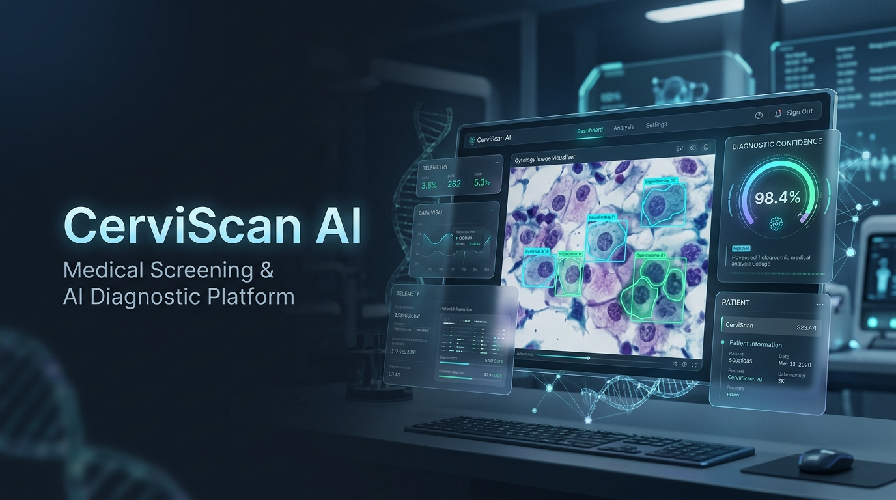

<div align="center">
  

  <h1>CerviScan-AI</h1>
  <p><strong>Computer vision research prototype for assisted cervical sample review.</strong></p>

  <p>
    <a href="https://cerviscan-ai.syahmiaof.my"></a>
    <a href="https://github.com/syahmiaof/CerviScan-AI"></a>
    <a href="LICENSE"></a>
    <a href="https://syahmiaof.my"></a>
  </p>

  <p>
    
    
    
    
    
    
    
    
  </p>
</div>

---

## Overview

- **Functionality**: Computer vision research prototype for assisted cervical sample review, streaming endoscope video feeds through custom frame pre-processing and YOLOv8 deep learning inference.
- **Aesthetic Value**: Modern clinical review dashboard engineered with high-contrast typography, ergonomic dark-mode surfaces, responsive layouts, and fluid data tables.
- **Business Value**: Accelerates exploratory clinical triaging workflows, reducing preliminary visual inspection latency while keeping diagnostic control strictly in certified human hands.

> **Research Prototype Disclaimer**: This project is a research prototype in active development. The public dashboard operates on demonstration data and is **not** a clinically validated medical diagnostic device. Output must be evaluated by certified professionals and cannot replace histopathology or clinician judgment.

---

## Technical Scope & Authorship

**Muhammad Syahmi (syahmiaof)** architected and implemented:
- **CMS & Review Dashboard**: Interactive React 19 UI with TanStack Table and Recharts data visualizations.
- **Stream Ingestion & Processing**: Endoscope video stream ingestion service and frame handling pipeline.
- **YOLOv8 Inference Pipeline**: Computer vision model integration, bounding box rendering, and result parsing.
- **Review Workflow**: Multi-criteria filtering, annotation history, and patient review management.

*Clinical methodology, physical hardware prototyping, and dataset collation are managed collaboratively with the research team.*

---

## Architecture Flow

```text
Imaging Source (Bebird / Digital Endoscope)
       │
       ▼
  Video Stream (UDP / RTSP / MJPEG)
       │
       ▼
Frame Pre-processing & Green Filter
       │
       ▼
 YOLOv8 Deep Learning Inference
       │
       ▼
Interactive Clinical Review Dashboard (React 19 + Express)
```

---

## Technology Stack

| Layer | Technologies |
|---|---|
| **Frontend Framework** | React 19, TypeScript, Vite |
| **Styling & Motion** | Tailwind CSS v4, Motion, Lucide React |
| **Data & Tables** | TanStack React Table v8, Recharts |
| **Service & API** | Node.js, Express, `@google/genai` |
| **Computer Vision** | YOLOv8 (Ultralytics), Python, OpenCV |
| **Deployment & Automation** | Vercel, GitHub Actions CI |

---

## Continuous Integration & Quality

Platform integrity is validated automatically via GitHub Actions CI:
- **Type Checking**: Strict TypeScript validation across all modules.
- **Bundle Production**: Tree-shaken production asset packaging via Vite.
- **Interface Sanity**: Continuous verification of component props, routing contracts, and static assets.

---

## Limitations & Compliance

- The dashboard contains demonstration records for interface verification and prototype evaluation.
- Model sensitivity and clinical validation metrics are subject to continuing institutional research.
- Regulatory and clinical clearance processes remain outside the scope of this repository.

---

## License

Copyright (c) 2026 Muhammad Syahmi ([syahmiaof](https://syahmiaof.my)). All rights reserved.  
Proprietary source code created solely for demonstration and portfolio showcase purposes.
